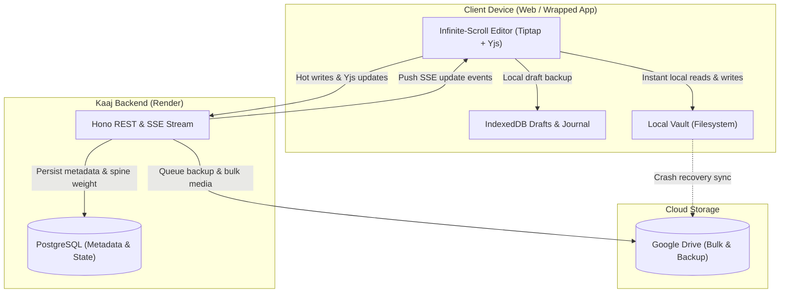
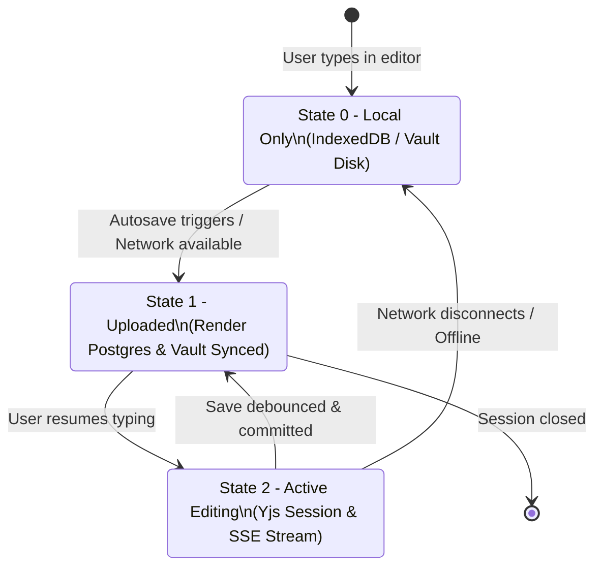
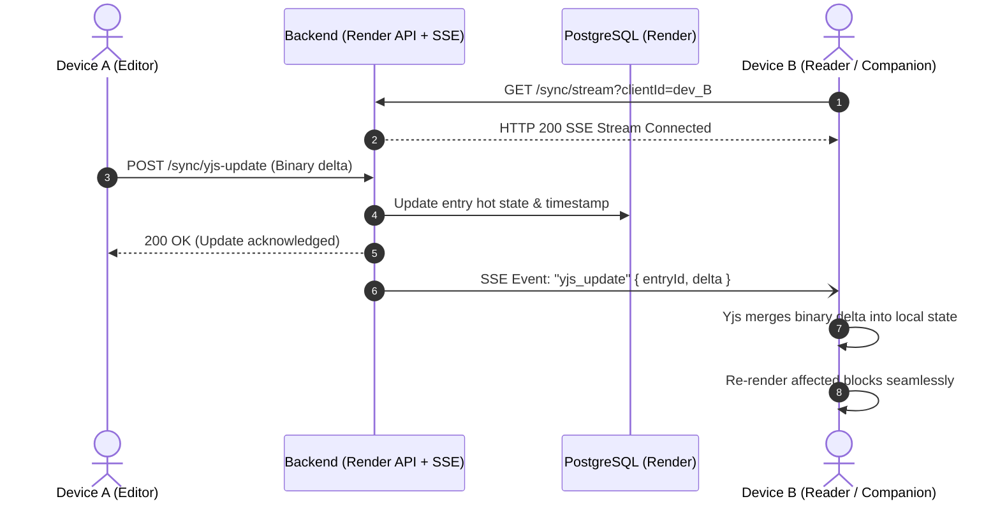

# Kaaj Storage and Synchronization Architecture

Specification v0.2 · 26 Oct 2026 · Status: LOCKED Architecture.

## 1. Overview

This document specifies the storage and synchronization system for Kaaj.
The architecture combines three storage tiers:
1. **Local Vault Folder:** provides instant local read and write operations on user devices.
2. **PostgreSQL on Render:** handles hot metadata writes, spine weights, and Server-Sent Events (SSE).
3. **Google Drive:** stores bulk binary data and full disaster recovery backups.



---

## 2. Chunk Model

The editor presents one continuous infinite-scroll document.
Storage splits this document into sequential chunks to ensure low latency and fast saves.

### 2.1 Chunk Definition and Boundaries

- A chunk contains an ordered list of top-level ProseMirror blocks (`paragraph`, `heading`, `bulletList`, `orderedList`, `blockquote`, `horizontalRule`, `image`).
- Each block has a unique, stable ID (`blk_<uuid>`).
- Chunk boundaries split automatically when either condition is met:
  1. Block count reaches **50 blocks** (DEFAULT).
  2. Serialized chunk JSON exceeds **64 KB** (DEFAULT).
- Splitting occurs only at top-level block boundaries. Blocks are never divided internally.

### 2.2 Chunk Manifest (`manifest.json`)

Each entry directory contains a `manifest.json` file.
The manifest records chunk order, chunk IDs, block counts, and checksums.

```json
{
  "entryId": "entry_ideas_1",
  "schemaVersion": 2,
  "version": 4,
  "totalBlocks": 128,
  "chunkCount": 3,
  "chunks": [
    {
      "id": "chk_01",
      "order": 0,
      "blockCount": 50,
      "bytes": 24510,
      "checksum": "sha256-a1b2c3..."
    },
    {
      "id": "chk_02",
      "order": 1,
      "blockCount": 50,
      "bytes": 28190,
      "checksum": "sha256-d4e5f6..."
    },
    {
      "id": "chk_03",
      "order": 2,
      "blockCount": 28,
      "bytes": 14200,
      "checksum": "sha256-g7h8i9..."
    }
  ],
  "updatedAt": "2026-10-26T10:30:00.000Z"
}
```

### 2.3 Individual Chunk Payload (`chunks/chk_01.json`)

```json
{
  "chunkId": "chk_01",
  "entryId": "entry_ideas_1",
  "blocks": [
    {
      "type": "heading",
      "attrs": { "id": "blk_a1b2", "level": 1, "textAlign": "left" },
      "content": [{ "type": "text", "text": "Field Notes" }]
    },
    {
      "type": "paragraph",
      "attrs": { "id": "blk_c3d4", "textAlign": "left" },
      "content": [{ "type": "text", "text": "Continuous stream content." }]
    }
  ]
}
```

### 2.4 Load and Save Mechanics

- **Initial Load:** the editor loads the manifest and initial visible chunks (chunks 1 and 2).
- **Infinite Scroll:** an `IntersectionObserver` detects scroll thresholds and requests subsequent chunks.
- **Selective Save:** editing marks only modified chunks as dirty. The client writes only dirty chunks to disk and backend.

---

## 3. Local Vault Layout

The local vault provides fast disk lookup and full offline capability.

```
<vault_root>/
  manifest.json                         # Vault metadata and category catalog
  categories/
    <category_id>.json                  # Category metadata, todo items, version
  entries/
    <entry_id>/
      entry.json                        # Entry metadata, title, weight, spine, sync state
      manifest.json                     # Chunk sequence and block metadata
      chunks/
        chk_01.json                     # Block group 1
        chk_02.json                     # Block group 2
        ...
  assets/
    asset_<uuid>.jpg                    # Original binary asset
    asset_<uuid>.png
    thumbs/
      asset_<uuid>_320.webp             # 320px WebP thumbnail
      asset_<uuid>_960.webp             # 960px WebP thumbnail
  journal/
    uncommitted-ops.jsonl               # Write-ahead log for crash recovery
```

### 3.1 Vault Rules

- The vault root is configured in application settings.
- Files write atomically: write to a temporary file (`.tmp`), flush to disk, then rename.
- Image assets store by `assetId`. File names never use client source names.

---

## 4. Google Drive Layout

Google Drive holds bulk binary storage and complete system backups.
Drive storage safeguards content against local disk failure or Render database recreation.

```
Google Drive: "Kaaj Archive/"
  backups/
    kaaj-backup-2026-10-26-120000.zip   # Full periodic database & vault snapshot
    kaaj-backup-latest.zip              # Symlinked / designated latest full backup
  data/
    manifest.json                       # Cloud archive catalog
    categories/
      <category_id>.json
    entries/
      <entry_id>/
        entry.json
        manifest.json
        chunks/
          chk_01.json
          chk_02.json
    assets/
      asset_<uuid>.jpg
      asset_<uuid>.png
      thumbs/
        asset_<uuid>_320.webp
        asset_<uuid>_960.webp
```

---

## 5. Sync States

Every entry possesses a sync state:
- **State 0 (Local Only):** Changes exist only on the local device (in the local vault or IndexedDB). The backend has not received these edits.
- **State 1 (Upload):** Changes successfully uploaded to backend. The backend wrote data to PostgreSQL, updated local store, and queued Drive backup.
- **State 2 (Editing):** An active live editing session is underway. Incremental updates stream via Yjs updates.



### State Transitions

| From | To | Trigger | Actions |
| --- | --- | --- | --- |
| None | State 0 | Local keystroke | Save to IndexedDB draft and vault journal |
| State 0 | State 1 | Idle timeout (1.5s) | Send dirty chunks to backend via `PUT /entries/:id/chunks` |
| State 1 | State 2 | Focus editor and type | Connect to SSE stream; send Yjs document updates |
| State 2 | State 1 | Idle 1.5s without typing | Flush dirty Yjs state into permanent chunks; update spine weight |
| State 2 | State 0 | Network interruption | Cache edits to IndexedDB; display offline badge |

---

## 6. Server-Sent Events (SSE) and Hot Writes

The backend coordinates live devices through Server-Sent Events (SSE) and HTTP hot writes.



### 6.1 SSE Protocol

- Endpoint: `GET /sync/stream`
- Headers:
  - `Content-Type: text/event-stream`
  - `Cache-Control: no-cache`
  - `Connection: keep-alive`
- Heartbeat: server transmits `:ping` comment every 15 seconds.
- Reconnection: client reconnects automatically with `Last-Event-ID` header.

### 6.2 Event Types

1. `yjs_update`: transmits base64 Yjs update delta for active editing sessions.
2. `chunk_saved`: informs other clients that a chunk was committed.
3. `entry_meta_updated`: broadcasts title, spine weight, or color changes.

---

## 7. Crash Recovery

Crash recovery guarantees zero data loss by combining the Google Drive base state with local uncommitted operations.


### 7.1 Recovery Principles

1. **Drive Is Base of Record:** Google Drive stores the authoritative disaster recovery snapshot.
2. **Local Is Head of Edits:** Uncommitted keystrokes exist in IndexedDB and the vault journal.
3. **Yjs Guarantees Conflict Resolution:** Replaying local binary updates onto the Drive base produces a deterministic document without merge conflicts.
4. **Draft Banner:** When recovery restores uncommitted work, a calm notification confirms: "Restored unsaved edits from local backup."

---

## 8. Open Questions for the Owner

The following items need your decision before implementation:

1. **Local Vault Location:**
   - Where should the local vault reside by default on desktop systems (e.g. `%APPDATA%/Kaaj/vault` on Windows, `~/Library/Application Support/Kaaj/vault` on macOS, or a user-selected directory)?
   - For web browser mode, should the vault use the Origin Private File System (OPFS) or standard IndexedDB?

2. **Google Drive Authentication Flow:**
   - Should Drive integration use a user-interactive OAuth2 consent flow (client secret and refresh token per user), or an automated Service Account with a dedicated shared Drive folder?

3. **Drive Backup Trigger Policy:**
   - When should full snapshot backups trigger to Google Drive?
     - Option A: After every save where sync state transitions to State 1.
     - Option B: Periodic scheduled background timer (e.g. every 15 or 30 minutes).
     - Option C: On entry close and application exit.

4. **Chunk Size Thresholds:**
   - Is **50 blocks** and **64 KB** the desired split boundary, or should chunks scale based on image density?
