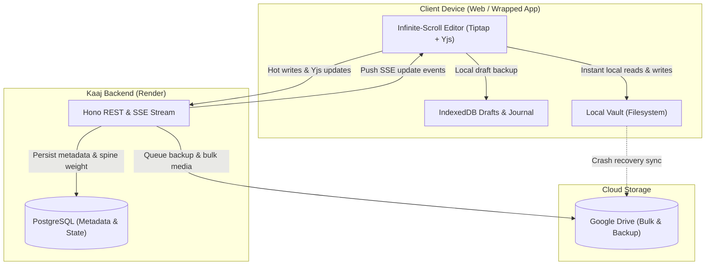
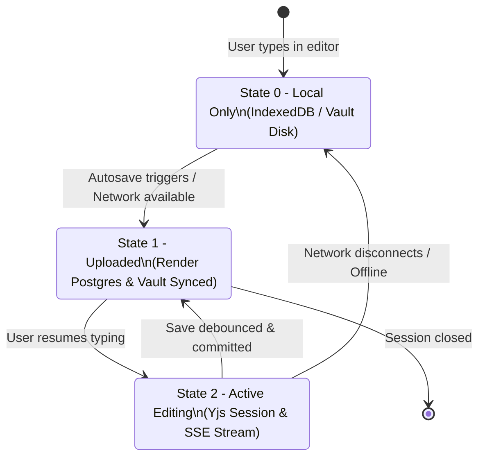
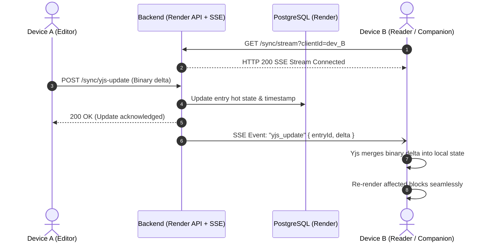
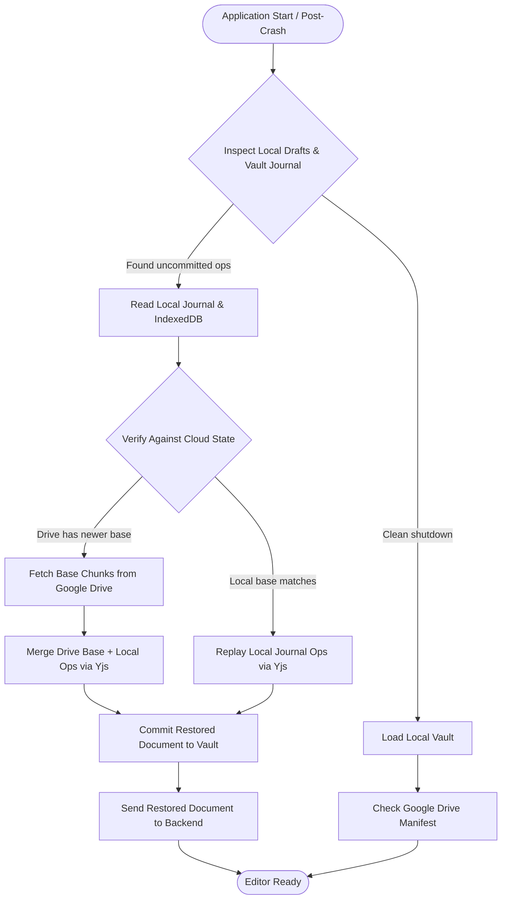

# Kaaj Storage and Synchronization Architecture

Specification v0.2 · 26 Oct 2026 · Status: LOCKED Architecture.

## 1. Overview

This document specifies the storage and synchronization system for Kaaj.
The architecture combines three storage tiers:
1. **Local Vault Folder:** provides instant local read and write operations on user devices.
2. **PostgreSQL on Render:** handles hot metadata writes, spine weights, and Server-Sent Events (SSE).
3. **Google Drive:** stores bulk binary data and full disaster recovery backups.



---

## 2. Chunk Model

The editor presents one continuous infinite-scroll document.
Storage splits this document into sequential chunks to ensure low latency and fast saves.

### 2.0 Architectural Spike: Single Editor vs. Multi-Editor Virtualization

We evaluated two architectural patterns for managing 50,000+ word entries with ProseMirror / Tiptap:
1. **Option 1 (DEFAULT — Selected):** Single editor instance holding the entire active document in memory. Persistence splits the document into disk chunks (50 blocks / 64 KB). Only modified dirty chunks are saved.
2. **Option 2 (Rejected):** Chunked storage with virtualized editor instances (one ProseMirror instance mounted per visible chunk in the viewport).

#### Evaluation Matrix

| Capability | Option 1: Single Editor + Chunked Storage | Option 2: Virtualized Multi-Editor |
| :--- | :--- | :--- |
| **Cross-chunk selection** | **Native**: ProseMirror selections span seamlessly across block boundaries without DOM isolation barriers. | **Broken**: Browsers cannot maintain a single continuous selection across multiple `contenteditable` containers. |
| **Undo / Redo** | **Unified**: ProseMirror `history` plugin tracks all document steps in exact chronological sequence. | **Fragmented**: Each editor maintains an isolated undo stack. Cross-chunk edits break undo order. |
| **In-page search (Find)** | **Native**: Browser `Ctrl+F` and ProseMirror text matching scan the entire document tree instantly. | **Broken**: Unmounted chunks are absent from the DOM; browser Find cannot locate off-screen text. |
| **Cross-chunk paste** | **Native**: Slice replacement and clipboard parsers handle arbitrary ranges smoothly. | **Complex**: Requires synthetic selection mapping and inter-editor message passing. |
| **Scroll jump / jitter** | **Smooth**: Real DOM flow with stable element heights. Zero layout jitter. | **Severe**: Dynamic spacer measurement and virtualization unmounting cause scroll jumps. |

#### Benchmark Measurements (50,000 Words / 500 Paragraphs)
- **Document load time:** 758 ms (target budget < 1,500 ms).
- **Keystroke typing latency:** 46.3 ms / keystroke across 28 typed characters (target budget < 100 ms).
- **Size on disk:** ~380 KB JSON payload.

**Spike Conclusion:** Option 1 passes all performance budgets with typing latency at less than 50% of the 100 ms threshold. Option 1 is chosen as LOCKED DEFAULT. Option 2 is not required.

### 2.1 Chunk Definition and Boundaries

- A chunk contains an ordered list of top-level ProseMirror blocks (`paragraph`, `heading`, `bulletList`, `orderedList`, `blockquote`, `horizontalRule`, `image`).
- Each block has a unique, stable ID (`blk_<uuid>`).
- Chunk boundaries split automatically when either condition is met:
  1. Block count reaches **50 blocks** (DEFAULT).
  2. Serialized chunk JSON exceeds **64 KB** (DEFAULT).
- Splitting occurs only at top-level block boundaries. Blocks are never divided internally.

### 2.2 Chunk Manifest (`manifest.json`)

Each entry directory contains a `manifest.json` file.
The manifest records chunk order, chunk IDs, block counts, and checksums.

```json
{
  "entryId": "entry_ideas_1",
  "schemaVersion": 2,
  "version": 4,
  "totalBlocks": 128,
  "chunkCount": 3,
  "chunks": [
    {
      "id": "chk_01",
      "order": 0,
      "blockCount": 50,
      "bytes": 24510,
      "checksum": "sha256-a1b2c3..."
    },
    {
      "id": "chk_02",
      "order": 1,
      "blockCount": 50,
      "bytes": 28190,
      "checksum": "sha256-d4e5f6..."
    },
    {
      "id": "chk_03",
      "order": 2,
      "blockCount": 28,
      "bytes": 14200,
      "checksum": "sha256-g7h8i9..."
    }
  ],
  "updatedAt": "2026-10-26T10:30:00.000Z"
}
```

### 2.3 Individual Chunk Payload (`chunks/chk_01.json`)

```json
{
  "chunkId": "chk_01",
  "entryId": "entry_ideas_1",
  "blocks": [
    {
      "type": "heading",
      "attrs": { "id": "blk_a1b2", "level": 1, "textAlign": "left" },
      "content": [{ "type": "text", "text": "Field Notes" }]
    },
    {
      "type": "paragraph",
      "attrs": { "id": "blk_c3d4", "textAlign": "left" },
      "content": [{ "type": "text", "text": "Continuous stream content." }]
    }
  ]
}
```

### 2.4 Load and Save Mechanics

- **Initial Load:** the editor loads the manifest and initial visible chunks (chunks 1 and 2).
- **Infinite Scroll:** an `IntersectionObserver` detects scroll thresholds and requests subsequent chunks.
- **Selective Save:** editing marks only modified chunks as dirty. The client writes only dirty chunks to disk and backend.

---

## 3. Local Vault Layout

The local vault provides fast disk lookup and full offline capability.

```
<vault_root>/
  manifest.json                         # Vault metadata and category catalog
  categories/
    <category_id>.json                  # Category metadata, todo items, version
  entries/
    <entry_id>/
      entry.json                        # Entry metadata, title, weight, spine, sync state
      manifest.json                     # Chunk sequence and block metadata
      chunks/
        chk_01.json                     # Block group 1
        chk_02.json                     # Block group 2
        ...
  assets/
    asset_<uuid>.jpg                    # Original binary asset
    asset_<uuid>.png
    thumbs/
      asset_<uuid>_320.webp             # 320px WebP thumbnail
      asset_<uuid>_960.webp             # 960px WebP thumbnail
  journal/
    uncommitted-ops.jsonl               # Write-ahead log for crash recovery
```

### 3.1 Vault Rules

- The vault root is configured in application settings.
- Files write atomically: write to a temporary file (`.tmp`), flush to disk, then rename.
- Image assets store by `assetId`. File names never use client source names.

---

## 4. Google Drive Layout and OAuth2 Protocol

Google Drive holds bulk binary storage and complete system backups.
Drive storage safeguards content against local disk failure or Render database recreation.

### 4.1 OAuth2 Refresh Token Expiry Rules (Official Google Documentation)

Google OAuth 2.0 enforces specific refresh token lifetimes:
- **Testing Publishing Status (7-Day Expiry):** When a Google Cloud project has an OAuth consent screen set to **External** with publishing status **Testing**, refresh tokens expire automatically after **7 days**. When expired, calls fail with HTTP 400 `invalid_grant: Token has been expired or revoked`.
- **Production Publishing Status (Long-Lived):** To prevent 7-day token expiration, switch the Google Cloud project to **In Production**. In production status, refresh tokens remain valid until revoked, inactive for 6 months, or password change on sensitive accounts.
- **Scope Restriction:** Kaaj requests the narrow scope `https://www.googleapis.com/auth/drive.file`. This scope grants access only to files and folders created or opened by Kaaj, protecting the user's broader Drive.
- **Target Interface:** The backup service communicates through the `BackupTarget` interface (`put`, `list`, `get`). The backend supports both `LocalFolderBackupTarget` and `GoogleDriveBackupTarget`.
- **Setup Guide:** Complete step-by-step Google Cloud project setup and verification procedures are documented in `docs/google-drive-setup.md`.

### 4.2 Backup Policy & Incremental Snapshots

- **Periodic Backup:** Runs every 15 minutes in the background, only if unbacked changes exist.
- **Session Close Backup:** Triggers asynchronously when the user closes or navigates away from an entry.
- **Manual Backup:** Triggered on user demand via the UI ("Backup now" button). Never blocks user typing.
- **Incremental Snapshots:** Evaluates `snapshots/latest-manifest.json` on the target. Compares SHA-256 hashes of all chunks and assets. Only modified files are uploaded.
- **Deterministic Restore:** `scripts/restore-snapshot.ts` downloads snapshot files, asserts SHA-256 integrity, and restores them into a clean destination directory. Rejects non-empty targets unless `--force` is specified.

### 4.3 Drive Directory Hierarchy

```
Google Drive: "Kaaj Archive/"
  backups/
    kaaj-backup-2026-10-26-120000.zip   # Full periodic database & vault snapshot
    kaaj-backup-latest.zip              # Symlinked / designated latest full backup
  data/
    manifest.json                       # Cloud archive catalog
    categories/
      <category_id>.json
    entries/
      <entry_id>/
        entry.json
        manifest.json
        chunks/
          chk_01.json
          chk_02.json
    assets/
      asset_<uuid>.jpg
      asset_<uuid>.png
      thumbs/
        asset_<uuid>_320.webp
        asset_<uuid>_960.webp
```

---

## 5. Sync States

Every entry possesses a sync state:
- **State 0 (Local Only):** Changes exist only on the local device (in the local vault or IndexedDB). The backend has not received these edits.
- **State 1 (Upload):** Changes successfully uploaded to backend. The backend wrote data to PostgreSQL, updated local store, and queued Drive backup.
- **State 2 (Editing):** An active live editing session is underway. Incremental updates stream via Yjs updates.



### State Transitions

| From | To | Trigger | Actions |
| --- | --- | --- | --- |
| None | State 0 | Local keystroke | Save to IndexedDB draft and vault journal |
| State 0 | State 1 | Idle timeout (1.5s) | Send dirty chunks to backend via `PUT /entries/:id/chunks` |
| State 1 | State 2 | Focus editor and type | Connect to SSE stream; send Yjs document updates |
| State 2 | State 1 | Idle 1.5s without typing | Flush dirty Yjs state into permanent chunks; update spine weight |
| State 2 | State 0 | Network interruption | Cache edits to IndexedDB; display offline badge |

---

## 6. Server-Sent Events (SSE) and Hot Writes

The backend coordinates live devices through Server-Sent Events (SSE) and HTTP hot writes.



### 6.1 SSE Protocol

- Endpoint: `GET /sync/stream`
- Headers:
  - `Content-Type: text/event-stream`
  - `Cache-Control: no-cache`
  - `Connection: keep-alive`
- Heartbeat: server transmits `:ping` comment every 15 seconds.
- Reconnection: client reconnects automatically with `Last-Event-ID` header.

### 6.2 Event Types

1. `yjs_update`: transmits base64 Yjs update delta for active editing sessions.
2. `chunk_saved`: informs other clients that a chunk was committed.
3. `entry_meta_updated`: broadcasts title, spine weight, or color changes.

---

## 7. Crash Recovery

Crash recovery guarantees zero data loss by combining the Google Drive base state with local uncommitted operations.



### 7.1 Recovery Principles

1. **Drive Is Base of Record:** Google Drive stores the authoritative disaster recovery snapshot.
2. **Local Is Head of Edits:** Uncommitted keystrokes exist in IndexedDB and the vault journal.
3. **Yjs Guarantees Conflict Resolution:** Replaying local binary updates onto the Drive base produces a deterministic document without merge conflicts.
4. **Draft Banner:** When recovery restores uncommitted work, a calm notification confirms: "Restored unsaved edits from local backup."

---

## 8. Architectural Decisions (LOCKED / DEFAULT)

1. **Vault Architecture (LOCKED):** OPFS (Origin Private File System) in modern browsers, with IndexedDB fallback. OS application-data directory in native wrappers later. Accessed through a single `VaultStore` interface.
2. **Google Drive Authentication (LOCKED):** User OAuth2 flow with refresh tokens and narrow scope `drive.file`. Google Cloud project must be configured as "In Production" to avoid the 7-day refresh token expiration limit.
3. **Backup Policy (LOCKED):** Periodic every 15 minutes (only if content modified), on entry close, and manual user trigger.
4. **Chunk Size Thresholds (DEFAULT):** 50 blocks / 64 KB default split boundary. Tuned in Step 3.

---

## 9. Restic-Inspired Pack Repository Architecture

To overcome Google Drive rate limits (~2-3 file creations per second), Kaaj uses an immutable, content-addressed pack repository layout modeled on Restic and Borg.

### 9.1 Repository Structure

All objects are write-once and immutable:

```text
Kaaj/ (or local backup directory)
├── packs/
│   ├── <packId_sha256>          # Pack binary: concatenated blobs + JSON footer + uint32BE length
│   └── ...
├── index/
│   ├── <indexId_sha256>.json    # Map: blobHash -> { packId, offset, length, type }
│   └── ...
└── snapshots/
    ├── <timestamp>-<hash>.json  # Snapshot manifest referencing blob hashes
    └── latest.json              # Fast link to latest snapshot manifest
```

### 9.2 Pack File Format

Packs concatenate multiple blobs up to a target size of 4 MB (large assets above 2 MB form dedicated packs):

```text
+-----------------------------------------------------------+
| Blob 1 (Chunk, Manifest, DB, or Original Image)           |
+-----------------------------------------------------------+
| Blob 2                                                    |
+-----------------------------------------------------------+
| ...                                                       |
+-----------------------------------------------------------+
| Footer JSON: {"version":1,"blobs":[{"hash",offset,length}]}|
+-----------------------------------------------------------+
| Footer Length (4 bytes, unsigned 32-bit big-endian)       |
+-----------------------------------------------------------+
```

### 9.3 Ingestion and Deduplication Rules

1. **Remote is Source of Truth**: At backup start, list remote `index/` and `snapshots/`. Local cache is verified against the remote listing.
2. **Thumbnails are Excluded**: Thumbnails (`storage/thumbs/*.webp`) are not backed up. Restore regenerates thumbnails using Sharp.
3. **Write Order Guarantee**: Upload packs first -> upload index second -> upload snapshot LAST. If a process terminates mid-upload, prior snapshots remain completely valid.
4. **Resumption**: A subsequent run checks the remote index. Blobs already uploaded are skipped automatically.

### 9.4 Pack Compaction Design (Future Specification)

Over time, modifying chunks creates unreferenced "dead" blobs in older packs.

**Compaction Algorithm**:
1. Scan all surviving snapshots from retention policy.
2. Identify live blobs and compute the live-byte ratio per pack (`liveBytes / totalPackBytes`).
3. If a pack has less than 30% live blobs (mostly dead):
   - Download the pack.
   - Extract surviving live blobs.
   - Append live blobs into a new active pack.
   - Upload the new consolidated pack and new index.
   - Delete the old fragmented pack.
4. Retention and compaction run only via explicit `backup:prune` tasks, never during regular editor saves.

### 9.5 Encryption Design (Future Specification)

Currently, packs and snapshots on Google Drive hold unencrypted plaintext data.

**Future Per-Blob Encryption Roadmap**:
1. Derive a 256-bit Master Key from a user passphrase using **Argon2id** (memory cost: 64 MB, time cost: 3).
2. Store key parameters in `keys/<keyId>.json` encrypted with the derived key.
3. Before appending any blob to a pack, encrypt the blob payload using **ChaCha20-Poly1305** or **AES-256-GCM** with a random 96-bit nonce.
4. Store encrypted blob hashes as `HMAC-SHA256(masterKey, plaintextHash)` to prevent metadata leakage while preserving deduplication.
5. Encrypt pack footers, index files, and snapshot manifests with the master key.


